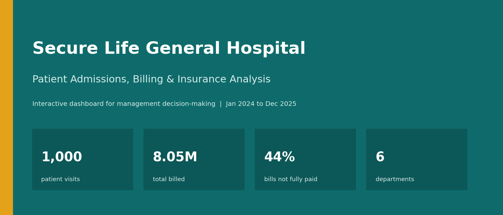
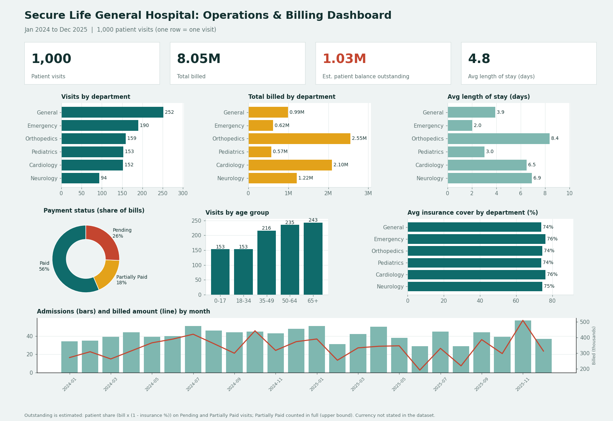

## Secure-Life-General-Hospital-Operations-Billing-Dashboard

## Introduction

Hospitals need to know how many patients they treat, how much they bill and how much of that money is actually paid. Secure Life General Hospital has noticed changes in patient admissions, outstanding medical bills and insurance coverage across its departments. This project turns 1,000 patient visit records (January 2024 to December 2025) into an interactive dashboard that shows management how the hospital is performing and where to act.

## About the Dataset

The hospital provided one table with 1,000 rows and 11 columns. Each row is one patient visit, not necessarily one unique patient.

| Field | Meaning |
|---|---|
| Patient ID | Unique ID for each visit or record |
| Patient Name | Name of the patient |
| Age | Age in years at the time of the visit |
| Gender | Gender as recorded |
| Admission Date | Date the patient was admitted |
| Discharge Date | Date the patient was discharged |
| Department | Where the patient was treated (Cardiology, Emergency, General, Neurology, Orthopedics, Pediatrics) |
| Diagnosis | Medical condition recorded (38 different diagnoses) |
| Total Bill Amount | Total charged for treatment and services |
| Insurance Coverage % | Share of the bill covered by insurance |
| Payment Status | Paid, Pending or Partially Paid |

**Data checks:** no missing values, no duplicate Patient IDs, no discharge date earlier than its admission date. Length of stay ranges from 1 to 14 days.

**Calculated fields:**
- Length of stay = discharge date minus admission date (days).
- Age groups: 0-17, 18-34, 35-49, 50-64, 65+.
- Estimated outstanding balance = Total Bill x (1 - Insurance %) for Pending and Partially Paid visits. The dataset has no amount received, so Partially Paid is counted in full. Treat the result as an upper limit.
- The dataset does not state a currency, so amounts are shown as recorded.

## Problem Statement

The management of Secure Life General Hospital has observed a change in patient admissions, outstanding medical bills and variations in insurance coverage across its departments. The hospital wants to use its admission, billing and insurance data to understand operational performance, monitor payments and improve decision-making, but it lacks a consolidated report giving a clear picture of its operational and financial performance.

As the data analyst, my task was to turn the raw data into meaningful insights and an interactive dashboard that answers these questions:

1. How many patient visits has the hospital recorded?
2. Which departments receive the highest number of patients?
3. Which departments generate the highest total bills?
4. What is the average length of stay across departments?
5. What proportion of bills is paid, pending or partially paid?
6. How much has the hospital billed, and how much remains outstanding?
7. How does insurance coverage vary across departments and diagnoses?
8. Which age groups account for the most visits?
9. How do admissions and billing change over time?
10. Which areas may need management attention?

## Visualization

The live dashboard has filters for department, payment status, year and gender. Every number and chart updates together.

## Insights

**Volume and billing**
- The hospital recorded **1,000 patient visits** and billed **8.05M** in total.
- **General** is the busiest department (252 visits), followed by Emergency (190) and Orthopedics (159). Neurology is the quietest (94).
- **Orthopedics** generates the highest bills (2.55M), then Cardiology (2.10M) and Neurology (1.22M). Together, these three departments account for about 73% of all billing.
- Average bill per visit is highest in Orthopedics (about 16,062) and Cardiology (about 13,786). Emergency, General and Pediatrics average roughly 3,300 to 3,900.

**Length of stay**
- The average stay is **4.8 days**. Orthopedics is longest (8.4 days), then Neurology (6.9) and Cardiology (6.5). Emergency is shortest (2.0).

**Payments**
- By count, **56.4%** of bills are Paid, **25.7%** Pending and **17.9%** Partially Paid. By value the split is 56.7% / 25.9% / 17.4%.
- About **1.03M** is estimated as outstanding patient balance. **Orthopedics** (about 314K) and **Cardiology** (about 263K) hold more than half of it.
- General and Pediatrics have the highest share of unpaid visits (about 47% and 46%), though their bills are small.

**Insurance**
- Average insurance cover is almost the same in every department (74% to 76%).
- Cover varies more by diagnosis, from about 62% for Asthma and 64% for Arrhythmia up to about 83% for Coronary Artery Disease and 82% for Stroke.
- **44 visits** have no insurance cover at all, and about 73% of them are unpaid.

**Patients and time**
- Visits rise with age: **65+ (243)** and **50-64 (235)** are the largest groups. Ages 0-17 and 18-34 have 153 each.
- Visits were slightly lower in 2025 (492) than in 2024 (508), and billing fell from 4.13M to 3.92M.
- Monthly admissions peaked in November 2025 (57) and were lowest in June 2025 (29).
- Visits are split almost evenly between Female (512) and Male (488) patients.

## Recommendations

1. **Focus payment follow-up on Orthopedics and Cardiology first.** They hold over half the estimated outstanding balance, so collecting from fewer, larger accounts gives the biggest result for the least effort.
2. **Check insurance at admission.** The 44 uninsured visits are mostly unpaid. Verifying cover early, and agreeing a payment plan, would reduce unpaid bills.
3. **Use simple reminders for General and Pediatrics.** Their unpaid share is high but the amounts are small, so automated SMS or call reminders are more practical than case-by-case follow-up.
4. **Review insurance gaps for low-cover diagnoses** such as Asthma and Arrhythmia, to see if patients are being asked to pay more than expected.
5. **Plan staffing and beds around demand.** Orthopedics, Neurology and Cardiology patients stay longest, and admissions swing from 29 to 57 a month, so capacity should follow the peaks.
6. **Record amounts actually received.** The dataset has no payment amounts, so outstanding can only be estimated. Capturing payments would make future reports exact.

## Conclusion

The dashboard gives Secure Life General Hospital the single, clear view it lacked. Most revenue and most unpaid balances come from a small number of departments, mainly Orthopedics and Cardiology, while insurance cover is steady across departments and varies by diagnosis. About 44% of visits are not fully paid, so payment follow-up is the clearest opportunity. Acting on the recommendations above, and recording payments received, would help management monitor performance and make better decisions.
